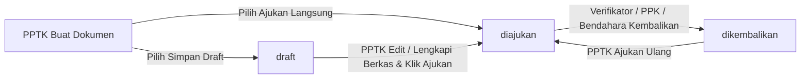
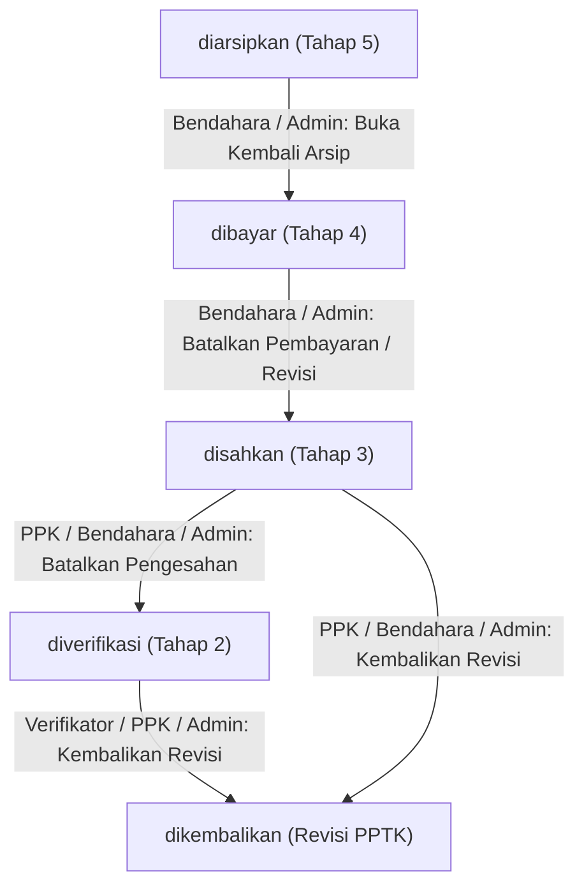

# Implementation Plan — Tindak Lanjut Catatan Blackbox Testing

Dokumen ini merinci rencana teknis untuk menyelesaikan 4 temuan pada [`catatan_blackbox_testing.md`](file:///c:/laragon/www/si-verif-blud/catatan_blackbox_testing.md) dengan tetap mematuhi standar arsitektur **Filament v5 (`Filament\Schemas\Schema`)**, state machine [`DokumenPengeluaran`](file:///c:/laragon/www/si-verif-blud/app/Models/DokumenPengeluaran.php), serta sinkronisasi aksi tabel & halaman detail.

---

## Ringkasan Akar Masalah (Root Cause Analysis)

| No | Temuan Blackbox Testing | Hasil Analisis Kode (Root Cause) |
| :-: | :--- | :--- |
| **1** | Belum ada fitur penyimpanan dokumen menjadi **Draft** saat mengajukan dokumen | - [`DokumenPengeluaran`](file:///c:/laragon/www/si-verif-blud/app/Models/DokumenPengeluaran.php#L12-L26) belum memiliki konstanta `STATUS_DRAFT = 'draft'`. - [`DokumenPengeluaranForm.php`](file:///c:/laragon/www/si-verif-blud/app/Filament/Resources/DokumenPengeluarans/Schemas/DokumenPengeluaranForm.php#L76-L77) memaksa `Hidden::make('status')->default('diajukan')` dan mewajibkan lampiran sejak awal. - Hook `static::created` pada [`DokumenPengeluaran.php`](file:///c:/laragon/www/si-verif-blud/app/Models/DokumenPengeluaran.php#L43-L58) langsung mengirim notifikasi ke seluruh Verifikator tanpa mengecek apakah dokumen masih berstatus `draft`. |
| **2** | Tidak bisa merubah status dokumen ke belakang (mis. sudah `diverifikasi` ternyata ada kekurangan, tidak bisa diubah menjadi `dikembalikan`) | - Pada [`DokumenPengeluaransTable.php`](file:///c:/laragon/www/si-verif-blud/app/Filament/Resources/DokumenPengeluarans/Tables/DokumenPengeluaransTable.php#L198) dan [`ViewDokumenPengeluaran.php`](file:///c:/laragon/www/si-verif-blud/app/Filament/Resources/DokumenPengeluarans/Pages/ViewDokumenPengeluaran.php#L132), aksi `verifikasi_kembalikan` hanya tampil saat status `diajukan` atau `dikembalikan`. - Begitu status berubah menjadi `diverifikasi` (atau `disahkan`), tombol **Kembalikan** hilang bagi Verifikator, PPK, maupun Bendahara/Admin. |
| **3** | Dashboard pada **PPTK Keuangan** belum menggambarkan data sebenarnya | - [`DokumenChart.php`](file:///c:/laragon/www/si-verif-blud/app/Filament/Widgets/DokumenChart.php#L38-L46) menampilkan grafik kepada role `pptk`, namun **tidak memfilter `where('pptk_id', auth()->id())`**, sehingga PPTK Keuangan melihat grafik pengajuan seluruh bidang RS meskipun kartu `Dokumen Saya` bernilai `0`. - [`StatsOverviewWidget::getPptkStats()`](file:///c:/laragon/www/si-verif-blud/app/Filament/Widgets/StatsOverviewWidget.php#L110-L132) hanya menghitung `Diajukan`, `Dikembalikan`, dan `Selesai (dibayar/diarsipkan)`, sehingga dokumen berstatus **`diverifikasi`** dan **`disahkan`** tidak tampil di rincian kartu. - [`DummyDokumenSeeder.php`](file:///c:/laragon/www/si-verif-blud/database/seeders/DummyDokumenSeeder.php) belum menyertakan sampel dokumen untuk PPTK Keuangan, SDM, dan Keperawatan. |
| **4** | Statistik di beberapa dashboard belum sesuai | - **Default Filter `7D`** di [`Dashboard.php`](file:///c:/laragon/www/si-verif-blud/app/Filament/Pages/Dashboard.php#L16-L21) memotong dokumen yang diajukan > 7 hari lalu sehingga angka di Dashboard berbeda dengan jumlah di menu Dokumen Pengeluaran. - **Kartu Admin/Manajemen** ([`getAdminStats()`](file:///c:/laragon/www/si-verif-blud/app/Filament/Widgets/StatsOverviewWidget.php#L80-L108)) tidak menampilkan kartu status **`Diverifikasi`**, sehingga penjumlahan per status tidak sama dengan `Total Dokumen`. - **Kartu Verifikator, PPK, & Bendahara** menghitung kinerja (`Diverifikasi Hari Ini`, `Disahkan Bulan Ini`, `Dibayar Bulan Ini`) dari kolom `dokumen_pengeluarans.status` saat ini; begitu dokumen lanjut ke tahap berikutnya (mis. `disahkan` -> `dibayar` -> `diarsipkan`), angka capaian bulan/hari tersebut hilang. - **Inkonsistensi Kolom Tanggal & Filter**: `StatsOverviewWidget` memfilter `tanggal_ajuan`, sedangkan `DokumenChart` dan `PengeluaranChart` memfilter `created_at`. `KoreksiPerBidangChart` & `WaktuVerifikasiChart` belum menggunakan `InteractsWithPageFilters`. |

---

## Rencana Perubahan per Temuan

### 1. Fitur Penyimpanan Dokumen sebagai Draft (`STATUS_DRAFT`)

1. **[`app/Models/DokumenPengeluaran.php`](file:///c:/laragon/www/si-verif-blud/app/Models/DokumenPengeluaran.php)**:
   - Menambahkan konstanta `const STATUS_DRAFT = 'draft';` dan memasukkannya ke dalam `ALL_STATUSES`.
   - Memperbarui hook `static::created`: hanya mengirim notifikasi *"Dokumen Baru Diajukan"* ke role `verifikator` apabila `$model->status === self::STATUS_DIAJUKAN`.
2. **[`app/Filament/Resources/DokumenPengeluarans/Schemas/DokumenPengeluaranForm.php`](file:///c:/laragon/www/si-verif-blud/app/Filament/Resources/DokumenPengeluarans/Schemas/DokumenPengeluaranForm.php)**:
   - Mengganti `Hidden::make('status')->default('diajukan')` menjadi pilihan mode simpan (`Select` / `Radio` / tombol aksi):
     - **`diajukan`** — *Ajukan Langsung ke Verifikator*
     - **`draft`** — *Simpan sebagai Draft (Belum Diajukan)*
   - Hanya ditampilkan saat pembuatan dokumen baru (`create`) atau saat mengedit dokumen yang masih berstatus `draft`.
   - Melonggarkan validasi `Repeater::make('file_path')` agar saat `status === 'draft'`, unggahan PDF/link Google Drive bersifat opsional (`defaultItems(0)` / tidak wajib diisi penuh), namun **wajib minimal 1 lampiran valid** saat disimpan sebagai `diajukan` atau saat menekan aksi **Ajukan Dokumen**.
3. **[`app/Filament/Resources/DokumenPengeluarans/DokumenPengeluaranResource.php`](file:///c:/laragon/www/si-verif-blud/app/Filament/Resources/DokumenPengeluarans/DokumenPengeluaranResource.php)**:
   - Pada `getEloquentQuery()`: memastikan dokumen berstatus `STATUS_DRAFT` hanya terlihat oleh PPTK pembuatnya (`pptk_id = auth()->id()`) serta `super_admin`/`admin` (tidak masuk ke daftar antrean `verifikator`, `ppk`, `bendahara`, `manajemen`, atau `rekanan`).
   - Menambahkan warna badge `gray` dan indikator tahap `0. Draft (Belum Diajukan)` pada `infolist()` Timeline Status Dokumen.
4. **[`app/Filament/Resources/DokumenPengeluarans/Pages/ListDokumenPengeluarans.php`](file:///c:/laragon/www/si-verif-blud/app/Filament/Resources/DokumenPengeluarans/Pages/ListDokumenPengeluarans.php)**:
   - Menambahkan tab **`Draft`** (khusus untuk `pptk`, `admin`, `super_admin`) dengan badge penghitung jumlah draft.
5. **Aksi `ajukan_draft` & Hak Edit/Hapus Draft**:
   - Pada [`DokumenPengeluaransTable.php`](file:///c:/laragon/www/si-verif-blud/app/Filament/Resources/DokumenPengeluarans/Tables/DokumenPengeluaransTable.php), [`ViewDokumenPengeluaran.php`](file:///c:/laragon/www/si-verif-blud/app/Filament/Resources/DokumenPengeluarans/Pages/ViewDokumenPengeluaran.php), dan [`EditDokumenPengeluaran.php`](file:///c:/laragon/www/si-verif-blud/app/Filament/Resources/DokumenPengeluarans/Pages/EditDokumenPengeluaran.php):
     - Mengizinkan PPTK mengedit (`EditAction`) dan menghapus (`DeleteAction`) dokumen berstatus `STATUS_DRAFT`.
     - Menambahkan aksi **`ajukan_draft` ("Ajukan ke Verifikator")** pada dokumen berstatus `STATUS_DRAFT` yang memvalidasi kelengkapan lampiran, mengubah status menjadi `STATUS_DIAJUKAN`, memperbarui `tanggal_ajuan` ke hari pengajuan jika diperlukan, dan mengirim notifikasi database ke `verifikator`.

---

### 2. Fitur Perubahan Status Dokumen ke Belakang (Kembalikan / Mundurkan Status)

1. **Perluasan Aksi `verifikasi_kembalikan` ("Kembalikan ke PPTK / Revisi")**:
   - Diselaraskan di [`DokumenPengeluaransTable.php`](file:///c:/laragon/www/si-verif-blud/app/Filament/Resources/DokumenPengeluarans/Tables/DokumenPengeluaransTable.php) dan [`ViewDokumenPengeluaran.php`](file:///c:/laragon/www/si-verif-blud/app/Filament/Resources/DokumenPengeluarans/Pages/ViewDokumenPengeluaran.php).
   - Dapat dijalankan ketika ditemukan kekurangan pada dokumen oleh:
     - **`verifikator`**: saat dokumen berstatus `diajukan` **maupun `diverifikasi`** (selama belum disahkan PPK, verifikator dapat menarik kembali verifikasi dan mengubah status menjadi `dikembalikan`).
     - **`ppk`**: saat dokumen berstatus `diverifikasi` **maupun `disahkan`** (PPK menemukan kekurangan saat memeriksa/setelah mengesahkan dan mengembalikannya ke PPTK menjadi `dikembalikan`).
     - **`bendahara`**: saat dokumen berstatus `disahkan` (Bendahara menemukan ketidaklengkapan berkas sebelum dibayar dan mengembalikannya menjadi `dikembalikan`).
     - **`super_admin` & `admin`**: saat dokumen berstatus `diajukan`, `diverifikasi`, `disahkan`, atau `dibayar`.
   - Tetap mewajibkan input `jenis_kesalahan_id` dan `catatan` revisi, mencatat ke tabel `verifikasis` (`hasil = 'dikembalikan'`) & `riwayat_koreksis` (`versi_ke` bertambah otomatis), serta mengirim notifikasi ke PPTK terkait (dan informasi ke Verifikator bila dikembalikan oleh PPK/Bendahara).
2. **Aksi `kembalikan_tahap` ("Mundurkan Tahap Sebelumnya")**:
   - Menambahkan aksi pendamping pada [`DokumenPengeluaransTable.php`](file:///c:/laragon/www/si-verif-blud/app/Filament/Resources/DokumenPengeluarans/Tables/DokumenPengeluaransTable.php) dan [`ViewDokumenPengeluaran.php`](file:///c:/laragon/www/si-verif-blud/app/Filament/Resources/DokumenPengeluarans/Pages/ViewDokumenPengeluaran.php) untuk memundurkan 1 tahap tanpa harus melempar balik ke PPTK jika hanya salah klik proses:
     - `diverifikasi` ➔ `diajukan` (oleh `verifikator`, `ppk`, `admin`, `super_admin`)
     - `disahkan` ➔ `diverifikasi` (oleh `ppk`, `bendahara`, `admin`, `super_admin`)
     - `dibayar` ➔ `disahkan` (oleh `bendahara`, `admin`, `super_admin`)
     - `diarsipkan` ➔ `dibayar` (oleh `bendahara`, `admin`, `super_admin`)
   - Dilengkapi konfirmasi alasan perubahan status dan otomatis tercatat oleh `AuditTrailObserver`.

---

### 3. Perbaikan Dashboard PPTK Keuangan & Isolasi Data PPTK

1. **[`app/Filament/Widgets/DokumenChart.php`](file:///c:/laragon/www/si-verif-blud/app/Filament/Widgets/DokumenChart.php)**:
   - Menambahkan isolasi query: jika `auth()->user()->hasRole('pptk')`, wajib memfilter `->where('pptk_id', auth()->id())` dan mengecualikan `STATUS_DRAFT`.
   - Mengubah acuan tanggal grafik dari `created_at` menjadi `tanggal_ajuan` agar 100% sinkron dengan filter periode dan kartu pada `StatsOverviewWidget`.
2. **[`app/Filament/Widgets/StatsOverviewWidget.php`](file:///c:/laragon/www/si-verif-blud/app/Filament/Widgets/StatsOverviewWidget.php) (`getPptkStats()`)**:
   - Memperbaiki rincian kartu statistik PPTK agar seluruh siklus dokumen tercakup dan totalnya selalu akurat:
     1. **Total Dokumen Saya** (seluruh dokumen yang diajukan di luar draft, dengan deskripsi jumlah draft bila ada)
     2. **Menunggu / Diproses** (`diajukan`, `diverifikasi`, `disahkan` — dilengkapi breakdown di deskripsi: mis. *"X Diajukan • Y Diverifikasi • Z Disahkan"*)
     3. **Dikembalikan (Revisi)** (`dikembalikan` — perlu tindakan PPTK)
     4. **Selesai Dicairkan** (`dibayar` & `diarsipkan` — dilengkapi total nominal realisasi bidangnya)
3. **[`database/seeders/DummyDokumenSeeder.php`](file:///c:/laragon/www/si-verif-blud/database/seeders/DummyDokumenSeeder.php)**:
   - Menambahkan data sampel dokumen pengeluaran untuk **PPTK Keuangan** (`pptk.keuangan@blud.com`), **PPTK SDM Litbang**, dan **PPTK Keperawatan** agar seluruh 6 bidang memiliki representasi data saat pengujian.

---

### 4. Perbaikan Statistik & Filter di Seluruh Dashboard Role Lainnya

1. **[`app/Filament/Pages/Dashboard.php`](file:///c:/laragon/www/si-verif-blud/app/Filament/Pages/Dashboard.php)**:
   - Mengubah default filter periode pada `mount()` dari `'7D'` menjadi `'all'` (*All time*) agar saat pengguna pertama kali membuka Dashboard, seluruh dokumen aktif langsung tergambar sesuai keadaan sebenarnya di tabel (pengguna tetap bebas memilih `1D`, `7D`, `1M`, `3M`, `YTD`, atau `Custom` kapan saja).
2. **[`app/Filament/Widgets/StatsOverviewWidget.php`](file:///c:/laragon/www/si-verif-blud/app/Filament/Widgets/StatsOverviewWidget.php)**:
   - **Semua Role (kecuali perhitungan draft internal PPTK)**: mengecualikan `STATUS_DRAFT` dari query dasar statistik eksekutif/verifikasi (`where('status', '!=', DokumenPengeluaran::STATUS_DRAFT)`).
   - **Admin, Super Admin, & Manajemen (`getAdminStats()`)**:
     - Menambahkan informasi/kartu status **`Diverifikasi` (Menunggu Pengesahan PPK)** yang sebelumnya terlewat, sehingga jumlah seluruh kartu status (`Diajukan` + `Dikembalikan` + `Diverifikasi` + `Disahkan` + `Dibayar` + `Diarsipkan`) **sama persis** dengan `Total Dokumen`.
   - **Verifikator (`getVerifikatorStats()`)**:
     - `Antrean Verifikasi`: menghitung dokumen berstatus `STATUS_DIAJUKAN` (yang benar-benar menunggu tindakan verifikator), terpisah dari `Dalam Revisi PPTK` (`STATUS_DIKEMBALIKAN`).
     - `Telah Diverifikasi (Lolos)`: menghitung berdasarkan riwayat `Verifikasi::where('hasil', 'lolos')` (atau dokumen yang telah melewati tahap verifikasi: `diverifikasi`, `disahkan`, `dibayar`, `diarsipkan`) agar angkanya tidak hilang saat dokumen disahkan oleh PPK.
   - **PPK (`getPpkStats()`)**:
     - Mengubah `getColumns()` menjadi `3` dan menampilkan:
       1. `Menunggu Pengesahan` (`status = diverifikasi`)
       2. `Telah Disahkan` (dihitung dari dokumen yang telah disahkan PPK: `status IN [disahkan, dibayar, diarsipkan]` atau tabel `Pengesahan`, sehingga tidak hilang saat sudah dibayar Bendahara)
       3. `Total Nilai Disahkan` (total nominal dokumen yang telah disahkan)
   - **Bendahara (`getBendaharaStats()`)**:
     - Memperbaiki duplikasi kartu `Dibayar Bulan Ini` vs `Menunggu Arsip`:
       1. `Menunggu Pembayaran` (`status = disahkan`)
       2. `Menunggu Arsip` (`status = dibayar`)
       3. `Total Terealisasi (Dibayar & Arsip)` (`status IN [dibayar, diarsipkan]` beserta total nominal pencairan `Rp ...`)
3. **Sinkronisasi Widget Grafik Lainnya**:
   - **[`PengeluaranChart.php`](file:///c:/laragon/www/si-verif-blud/app/Filament/Widgets/PengeluaranChart.php)**: menambahkan `'bendahara'` pada `canView()` (sesuai permission di `DatabaseSeeder`) dan menggunakan `tanggal_ajuan` sebagai basis tanggal agar konsisten dengan filter Dashboard.
   - **[`KoreksiPerBidangChart.php`](file:///c:/laragon/www/si-verif-blud/app/Filament/Widgets/KoreksiPerBidangChart.php)** & **[`WaktuVerifikasiChart.php`](file:///c:/laragon/www/si-verif-blud/app/Filament/Widgets/WaktuVerifikasiChart.php)**: menambahkan trait `InteractsWithPageFilters` agar grafik ikut terfilter sesuai rentang tanggal yang dipilih di toolbar Dashboard.

---

## Rencana Verifikasi & Pengujian

1. **Pemeriksaan Sintaks & Gaya Kode**:
   - Menjalankan `php -l` pada seluruh berkas yang dimodifikasi.
   - Menjalankan `./vendor/bin/pint --test`.
2. **Pengujian Otomatis (Feature/Unit Test)**:
   - Menambahkan/memperbarui pengujian di `tests/Feature/` untuk memverifikasi:
     - Pembuatan dokumen sebagai `draft` (tidak memicu notifikasi verifikator) dan pengajuan `draft` ➔ `diajukan` (memicu notifikasi verifikator).
     - Pengembalian status dokumen dari `diverifikasi` ➔ `dikembalikan` dan mundur tahap (`diverifikasi` ➔ `diajukan`, `disahkan` ➔ `diverifikasi`).
     - Isolasi data `StatsOverviewWidget` dan `DokumenChart` untuk akun `pptk.keuangan@blud.com` serta konsistensi total statistik di seluruh role.
   - Menjalankan `php artisan test`.
